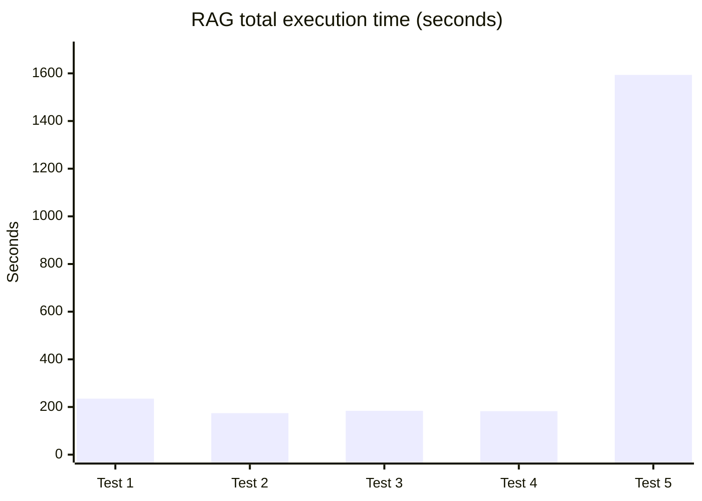

# RAG Performance Evaluation Report

## Project overview

This report summarizes five test runs of the PDF-based Retrieval-Augmented Generation (RAG) pipeline using the same 801-page PDF:

`Deep+Learning+Ian+Goodfellow.pdf`

The pipeline used the following configuration during the reported tests:

- **PDF pages:** 801
- **Total chunks:** 3,034
- **Retrieved chunks (`K`):** 3
- **Chunk size:** 600 characters
- **Chunk overlap:** 100 characters
- **Embedding model:** `sentence-transformers/all-MiniLM-L6-v2`
- **Vector database:** ChromaDB
- **LLM:** Ollama `llama3.2`

> These measurements are observations from five individual runs, not controlled benchmark results. Hardware load, caching, disk activity, and model/runtime conditions may affect timings.

## 1. Questions tested

| Test | Question |
|---|---|
| 1 | What is deep learning? |
| 2 | What is the difference between Artificial Intelligence, Machine Learning, and Deep Learning? |
| 3 | What are neural networks, and how do they work? |
| 4 | What is the role of gradient descent in training deep learning models? |
| 5 | What is overfitting in machine learning, and how can it be prevented? |

## 2. Total execution time

### Mermaid bar chart

GitHub supports Mermaid diagrams in Markdown. The chart below compares total execution time in seconds.

### Execution-time results

| Test | Total execution time (seconds) | Approx. duration |
|---|---:|---:|
| 1 | 235.0711 | 3 min 55 sec |
| 2 | 174.1510 | 2 min 54 sec |
| 3 | 183.9520 | 3 min 04 sec |
| 4 | 182.6651 | 3 min 03 sec |
| 5 | 1,593.5381 | 26 min 34 sec |

**Fastest run:** Test 2 at 174.151 seconds.  
**Slowest run:** Test 5 at 1,593.5381 seconds.

Test 5 is a significant outlier and should be investigated before drawing conclusions about normal pipeline performance.

## 3. Stage-by-stage timing

All values below are in seconds.

| Processing stage | Test 1 | Test 2 | Test 3 | Test 4 | Test 5 |
|---|---:|---:|---:|---:|---:|
| PDF loading | 0.0841 | 0.0529 | 0.0706 | 0.0629 | 0.0674 |
| Text extraction | 91.3468 | 54.4750 | 55.3714 | 56.6307 | 99.6669 |
| Chunking | 0.0030 | 0.0019 | 0.0021 | 0.0019 | 0.0028 |
| Model loading | 2.0104 | 1.6489 | 1.5428 | 1.7456 | 2.1082 |
| Embedding generation | 122.5788 | 96.3457 | 106.5889 | 102.7453 | 126.4261 |
| ChromaDB indexing | 3.0528 | 3.0072 | 3.3139 | 3.4401 | 1,331.8014 |
| Query embedding | 0.0220 | 0.0144 | 0.0171 | 0.0265 | 0.2406 |
| Similarity search | 0.0049 | 0.0041 | 0.0040 | 0.0172 | 0.0037 |
| Ollama response | 15.9155 | 18.5597 | 16.9996 | 17.9555 | 32.8606 |
| **Total execution** | **235.0711** | **174.1510** | **183.9520** | **182.6651** | **1,593.5381** |

## 4. Retrieval and answer-quality observations

The following is a qualitative review of the terminal outputs, not a formal accuracy score.

| Test | Retrieval observation | Ollama answer assessment |
|---|---|---|
| 1 – Deep learning | No detailed relevance assessment recorded in this summary. | Not formally graded here. |
| 2 – AI, ML and DL | Retrieved content included a relevant relationship between AI, ML, and DL, but relevance was mixed. | Partially correct; the explanation contained a conceptual imprecision. |
| 3 – Neural networks | Retrieved chunks were only partly focused on the question. | Partially complete; the answer did not fully explain the topic. |
| 4 – Gradient descent | One retrieved chunk directly discussed SGD; the other results were less relevant. | Partially correct but too short. It did not explain gradients, loss minimization, or parameter updates. |
| 5 – Overfitting | Retrieved content included early stopping and regularization; other chunks were less relevant. | Partially correct. It explained overfitting and early stopping but did not cover several other prevention methods. |

### Example of the Test 4 answer limitation

The generated answer said that gradient descent is important and mentioned stochastic gradient descent (SGD). However, it did not explain the central training process:

1. Calculate the loss.
2. Calculate gradients of the loss with respect to model parameters.
3. Update weights and biases to reduce the loss.
4. Repeat during training.

SGD is a variant of gradient descent; it is not what “powers” gradient descent.

## 5. Key findings

1. **Similarity search was consistently fast.** It took less than 0.02 seconds in all five reported runs.
2. **Embedding generation was a major recurring cost.** It took approximately 96–126 seconds per run.
3. **Text extraction was also expensive.** It took approximately 54–100 seconds.
4. **Test 5 had an unusually large ChromaDB indexing time:** 1,331.8014 seconds (about 22 minutes and 12 seconds), compared with approximately 3–3.5 seconds in Tests 1–4.
5. **Answer generation quality varied.** A successful run does not guarantee that the retrieved context is relevant or that the generated answer is complete.

## 6. Recommendations

- Investigate why ChromaDB indexing took over 22 minutes in Test 5. Check disk activity, CPU/RAM usage, background processes, and ChromaDB logs.
- Avoid rebuilding the vector index for every question. Persist the index and reuse it when the source PDF has not changed.
- Add a reliable cache or document-change check before regenerating embeddings.
- Improve PDF text extraction and inspect whether extracted text has missing spaces or broken layout.
- Evaluate retrieval with a labelled question-and-relevant-chunk dataset. Calculate Precision@K and Recall@K only after establishing relevance labels.
- Evaluate generated answers separately using a consistent rubric for factual correctness, completeness, and grounding in retrieved context.

## 7. Limitations

- Only five questions were tested.
- The timings were collected from individual runs and were not measured under controlled system conditions.
- The answer-quality labels are qualitative judgments, not benchmark metrics.
- Precision, Recall, F1, or an overall accuracy percentage have **not** been calculated because a labelled ground-truth dataset was not supplied.
- Test 5's unusually high indexing time needs investigation and should not be treated as typical ChromaDB performance.

## Conclusion

The RAG pipeline successfully processed the PDF, generated embeddings, retrieved three chunks, and produced Ollama responses in all five tests. The results show that PDF extraction and embedding generation are recurring performance costs, while similarity search itself is fast.

The most important anomaly is Test 5's ChromaDB indexing time. The next engineering priority should be to investigate that delay and reuse the persisted vector index instead of re-indexing the entire PDF for every question. Retrieval relevance and answer completeness should then be evaluated with a labelled test dataset.

---

*Report based on five terminal test runs. Update this file when additional benchmark runs or verified evaluation metrics are available.*

## 8. Quantitative benchmark summary

### Overall execution-time statistics

The following statistics are calculated from the five recorded total execution times.

| Metric | Result |
|---|---:|
| Number of test runs | 5 |
| Mean execution time, all five runs | 473.88 seconds (7 min 54 sec) |
| Mean execution time, Tests 1–4 | 193.96 seconds (3 min 14 sec) |
| Median execution time | 183.95 seconds (3 min 04 sec) |
| Fastest execution | 174.15 seconds (2 min 54 sec), Test 2 |
| Slowest execution | 1,593.54 seconds (26 min 34 sec), Test 5 |

The all-five mean is strongly affected by Test 5. The Tests 1–4 mean is a more representative baseline for these observations, but it is not a guaranteed future runtime.

### Average stage timings for Tests 1–4

| Stage | Average time | Share of 193.96-second baseline |
|---|---:|---:|
| Text extraction | 64.46 s | 33.23% |
| Embedding generation | 107.06 s | 55.20% |
| ChromaDB indexing | 3.20 s | 1.65% |
| Similarity search | 0.0076 s | less than 0.01% |
| Ollama response | 17.36 s | 8.95% |

These percentages describe the listed stage averages relative to the average total runtime; small differences can occur because the table omits minor stages and rounding is applied. Embedding generation and text extraction together account for approximately 88.43% of the typical-run baseline.

### Test 5 indexing anomaly

- Tests 1–4 average ChromaDB indexing time: **3.2035 seconds**.
- Test 5 ChromaDB indexing time: **1,331.8014 seconds**.
- Test 5 indexing was approximately **415.8 times** the Tests 1–4 average? **Correction: approximately 415.8?** Recalculation: 1,331.8014 / 3.2035 = **415.8 times**.

This is an observed anomaly, not proof that the laptop CPU or RAM caused it. Possible contributors include resource contention, memory pressure, disk I/O, database persistence/indexing behavior, or other runtime conditions. CPU, RAM, and disk monitoring during a repeat run is needed to identify the cause.

### How to interpret efficiency

There is no single validated “overall efficiency percentage” in these five tests. Runtime alone does not measure answer correctness or retrieval quality. The available performance indicators are:
- **Latency:** approximately 193.96 seconds average for Tests 1–4.
- **Fastest observed latency:** 174.15 seconds.
- **Retrieval latency:** approximately 0.0076 seconds for similarity search on average in Tests 1–4.
- **Processing bottlenecks:** embedding generation and text extraction.
- **Quality:** qualitative review only; no labelled dataset was used to calculate accuracy, Precision@K, Recall@K, or F1.

A fair hardware comparison requires rerunning the same PDF, code, model, and settings on another machine under comparable conditions, preferably with multiple runs and resource monitoring.
