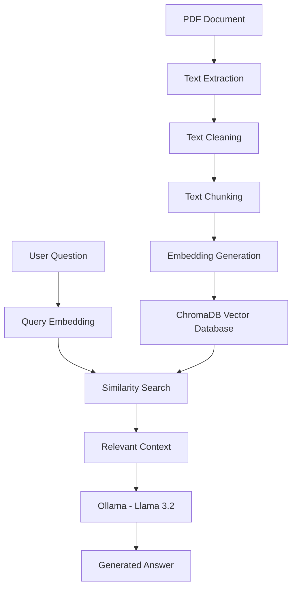

# RAG-Based Intelligent Document Question Answering System

A Python-based Retrieval-Augmented Generation (RAG) project that processes PDF documents, retrieves relevant passages through semantic search, and generates context-aware answers using a locally running Large Language Model (LLM).

## Overview

Searching long documents manually can take time. This project demonstrates how Retrieval-Augmented Generation can make document question answering easier.

The application extracts text from a PDF, cleans and divides the text into overlapping chunks, converts the chunks into embeddings, and stores them in ChromaDB. When a user asks a question, the system retrieves relevant chunks and sends them as context to the Llama 3.2 model through Ollama.

**Current version:** A Python command-line application for PDF-based question answering. A graphical web or mobile application is planned for a future stage.

## Key Features

- PDF text extraction using PyPDF.
- Text cleaning and preprocessing.
- Overlapping text chunk generation.
- Semantic embeddings using Sentence Transformers.
- Vector storage and similarity search using ChromaDB.
- Retrieval of the top relevant chunks for a question.
- Local answer generation using Ollama and Llama 3.2.

## System Architecture



## Technology Stack

| Component | Technology |
|---|---|
| Programming language | Python |
| PDF processing | PyPDF |
| Embedding framework | Sentence Transformers |
| Embedding model | all-MiniLM-L6-v2 |
| Embedding dimensions | 384 |
| Vector database | ChromaDB |
| LLM runtime | Ollama |
| Language model | Llama 3.2 |
| HTTP communication | Requests |

## How the RAG Pipeline Works

1. **PDF extraction:** PyPDF reads the PDF and extracts available text.
2. **Preprocessing:** Python regular expressions clean unnecessary whitespace.
3. **Chunking:** The text is divided into smaller overlapping sections.
4. **Embedding generation:** all-MiniLM-L6-v2 converts each chunk into a 384-dimensional vector.
5. **Vector storage:** ChromaDB stores the chunks and their embeddings.
6. **Retrieval:** The user's question is embedded and compared with stored vectors. The system retrieves the top matching chunks.
7. **Generation:** The retrieved context and question are sent to Llama 3.2 through Ollama to generate an answer.

### Chunking Configuration

| Parameter | Value |
|---|---:|
| Chunk size | 600 characters |
| Chunk overlap | 100 characters |
| Step size | 500 characters |

These settings are character-based, not token-based.

## Project Structure

```text
RAG-Based-Intelligent-Document-Question-Answering-System/
├── main.py
├── requirements.txt
├── README.md
├── Research.md
├── Notes.txt
├── LICENSE
├── .gitignore
└── chroma_db/  (created locally when the application runs)
```

The ChromaDB directory and Python virtual environment are generated locally and should generally be excluded from Git using `.gitignore`.

## Installation and Setup

### Prerequisites

- Python 3.10 or later
- Git
- Ollama
- The Llama 3.2 model

### 1. Clone the repository

```bash
git clone https://github.com/3161-harshit/RAG-Based-Intelligent-Document-Question-Answering-System.git
cd RAG-Based-Intelligent-Document-Question-Answering-System
```

### 2. Create and activate a virtual environment

On Windows PowerShell:

```powershell
python -m venv .venv
.\.venv\Scripts\Activate.ps1
```

### 3. Install Python dependencies

```bash
python -m pip install --upgrade pip
pip install -r requirements.txt
```

### 4. Install and prepare Ollama

Install Ollama separately, then download the model:

```bash
ollama pull llama3.2
```

Make sure the Ollama service is running before asking the application to generate an answer. The Python code communicates with Ollama through its local HTTP API.

### 5. Run the application

Pass the path to your PDF with the `--pdf` option:

```powershell
python main.py --pdf "C:\path\to\your\document.pdf"
```

The program then prompts you to enter a question.

You can also provide the question directly:

```powershell
python main.py "What is the main topic of this document?" --pdf "C:\path\to\your\document.pdf"
```

Optional arguments include:

- `--model`: choose an Ollama model name (defaults to `llama3.2`).
- `--top-k`: set how many relevant chunks to retrieve (defaults to `3`).

Replace the example PDF path with the actual path to a PDF on your computer.

## Example Questions

- What is the main topic of this document?
- Summarize the important points.
- Explain the methodology discussed in the document.
- What are the key findings?
- What conclusion does the document present?

The answer depends on the text extracted from the selected PDF and the passages retrieved for the question.

## Initial Implementation Results

The initial ingestion run reported the following results:

| Metric | Result |
|---|---:|
| PDF processing | Successful |
| Text chunks generated | 18 |
| Chunk size | 600 characters |
| Chunk overlap | 100 characters |
| Embedding model | all-MiniLM-L6-v2 |
| Embedding dimensions | 384 |
| Vector database | ChromaDB |
| Records stored | 18 |

The number of chunks and stored records will vary depending on the PDF document.

## Development Roadmap

**Roadmap legend:** [x] means implemented in the current code. [ ] means planned or not yet implemented.

### Completed

- [x] PDF text extraction
- [x] Text preprocessing
- [x] Document chunking
- [x] Embedding generation
- [x] ChromaDB integration
- [x] Semantic retrieval implementation
- [x] Ollama local LLM integration
- [x] Context-aware answer generation

### Planned

- [ ] Retrieval quality evaluation and improvement (for example, reranking and tuning)
- [ ] Automated tests and broader testing with different PDF documents
- [ ] FastAPI backend
- [ ] User-friendly web or mobile frontend
- [ ] Multiple document upload and management
- [ ] Source references for generated answers
- [ ] Android application development and testing

The checked items describe functionality present in the current Python implementation. The unchecked items are future development work; they should only be checked after they have actually been implemented and tested.

## Future Scope

The current project runs through the command line. In a future development stage, I plan to turn it into a complete software application with a user-friendly interface. The planned application may allow users to upload documents, manage multiple files, ask questions through a chat-style interface, and view the source passages used to generate answers.

Possible future extensions include support for additional formats such as DOCX and TXT, OCR for scanned documents, improved retrieval and ranking, and a web or mobile interface. These are planned enhancements and are not features of the current version.

## Learning Outcomes

This project provides practical experience with:

- Retrieval-Augmented Generation (RAG)
- Natural Language Processing (NLP)
- Text embeddings and semantic similarity
- Vector database management
- Document processing pipelines
- Local Large Language Model integration
- Python application development

## Author

**Harshit**  
2026 CSE Graduate | KIIT

Interests: Artificial Intelligence, Machine Learning, NLP, Generative AI, LLMs, RAG, and Backend Development.

## License

This project is licensed under the MIT License. See the `LICENSE` file for details.
