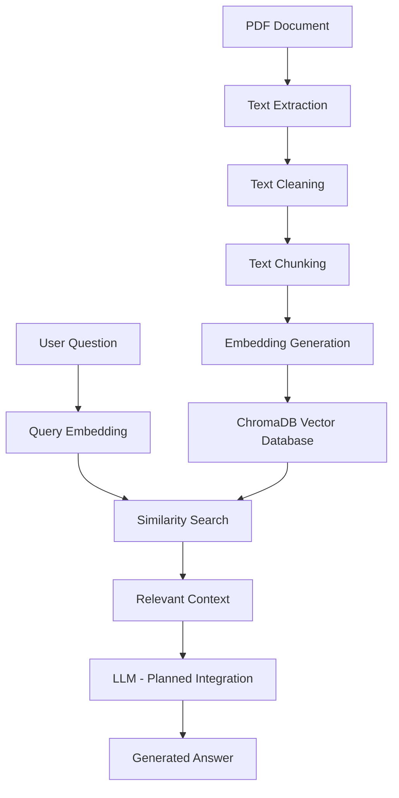

# RAG-Based Intelligent Document Question Answering System

A Python-based Retrieval-Augmented Generation (RAG) application that enables users to upload PDF documents, search their content semantically, and obtain context-aware answers using Large Language Models (LLMs).

## Overview

Traditional document searching often requires users to manually browse through lengthy PDF files to find specific information.

This project aims to simplify that process by combining document processing, semantic search, vector databases, and Large Language Models.

The system extracts text from PDF documents, divides it into smaller chunks, converts those chunks into numerical embeddings, and stores them in a vector database. When a user asks a question, the system retrieves relevant information that can be passed to an LLM to generate a contextual response.

## Key Features

- **PDF Text Extraction:** Extracts text from PDF documents using PyPDF.
- **Text Preprocessing:** Cleans extracted text by removing unnecessary whitespace.
- **Intelligent Chunking:** Divides large documents into smaller, overlapping text chunks.
- **Embedding Generation:** Converts text chunks into numerical vectors using Sentence Transformers.
- **Vector Database:** Stores document embeddings using ChromaDB.
- **Semantic Search:** Retrieves relevant document passages based on user queries.
- **LLM Integration:** Planned integration with a locally running LLM through Ollama for context-aware answer generation.

## System Architecture



## Technology Stack

| Component               | Technology                   |
| ----------------------- | ---------------------------- |
| Programming Language    | Python                       |
| PDF Processing          | PyPDF                        |
| Embedding Model         | Sentence Transformers        |
| Embedding Model Name    | all-MiniLM-L6-v2             |
| Vector Database         | ChromaDB                     |
| LLM Runtime             | Ollama (planned integration) |
| Development Environment | Visual Studio Code           |

## Project Workflow

### 1. PDF Text Extraction

The application uses PyPDF to read PDF documents and extract their text content.

### 2. Text Preprocessing

Extracted text is cleaned using Python regular expressions to remove unnecessary whitespace and improve consistency.

### 3. Text Chunking

Large documents are divided into smaller overlapping chunks.

Current configuration:

- Chunk Size: 600 characters
- Chunk Overlap: 100 characters

Overlapping helps preserve contextual information between consecutive chunks.

### 4. Embedding Generation

The Sentence Transformers model `all-MiniLM-L6-v2` converts each text chunk into a 384-dimensional vector representation.

These embeddings capture semantic information and enable similarity-based retrieval.

### 5. Vector Storage

ChromaDB stores the generated embeddings along with their corresponding text and metadata.

The database uses cosine distance for similarity comparison.

### 6. Semantic Retrieval

When a user enters a question, the system converts it into an embedding and searches the vector database for the most relevant document chunks.

### 7. Answer Generation

The next development stage is integrating a local LLM through Ollama to generate answers using the retrieved document context.

## Project Structure

```text
RAG-Document-QA/
│
├── documents/
│   └── sample.pdf
│
├── chroma_db/
│
├── main.py
│
├── README.md
├── requirements.txt
├── .gitignore
└── LICENSE
```

Note: `chroma_db/` is generated locally and should not be committed to GitHub.

## Installation and Setup

### Prerequisites

- Python 3.10 or later
- Git
- Visual Studio Code

### Step 1: Clone the Repository

```bash
git clone https://github.com/YOUR_USERNAME/RAG-Document-QA.git
```

```bash
cd RAG-Document-QA
```

### Step 2: Create a Virtual Environment

```bash
python -m venv .venv
```

Activate it on Windows:

```powershell
.venv\Scripts\Activate.ps1
```

### Step 3: Install Dependencies

```bash
pip install -r requirements.txt
```

### Step 4: Run the Application

```bash
python main.py
```

## Current Implementation Results

The initial document ingestion and embedding pipeline has been successfully executed.

| Metric               | Result           |
| -------------------- | ---------------- |
| PDF Processing       | Successful       |
| Text Chunking        | 18 chunks        |
| Chunk Size           | 600 characters   |
| Chunk Overlap        | 100 characters   |
| Embedding Model      | all-MiniLM-L6-v2 |
| Embedding Dimensions | 384              |
| Vector Database      | ChromaDB         |
| Stored Records       | 18               |

## Development Roadmap

- [ ] PDF text extraction
- [ ] Text preprocessing
- [ ] Document chunking
- [ ] Embedding generation
- [ ] ChromaDB integration
- [ ] Complete semantic retrieval testing
- [ ] Ollama local LLM integration
- [ ] Context-aware answer generation
- [ ] FastAPI backend integration
- [ ] React Native frontend
- [ ] Android application testing

## Learning Outcomes

Through this project, I am exploring and implementing:

- Retrieval-Augmented Generation (RAG)
- Natural Language Processing (NLP)
- Text embeddings and semantic similarity
- Vector database management
- Document processing pipelines
- Large Language Model integration
- Backend application development

## Future Scope

The project can be extended with:

- Support for multiple document formats.
- Multiple PDF uploads and document collections.
- Improved retrieval techniques.
- Source references for generated answers.
- Conversational question answering.
- A mobile-friendly user interface.
- Local and privacy-conscious LLM execution.

## Author

**Your Name**

2026 CSE Graduate | KIIT

Interests: Artificial Intelligence, Machine Learning, NLP, Generative AI, LLMs and Backend Development.

## License

This project is licensed under the MIT License. See the `LICENSE` file for details.
