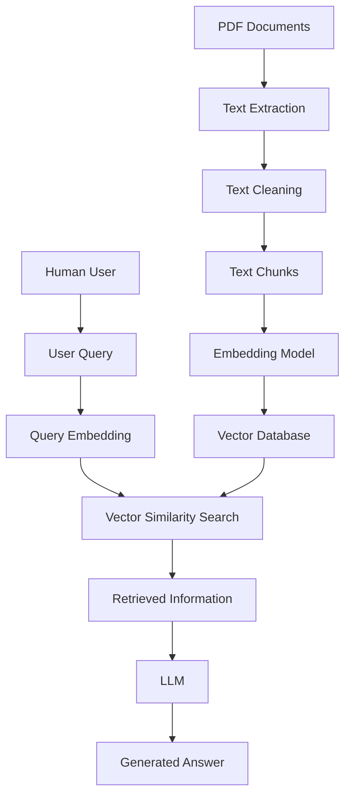

# RAG System Implementation
## A Technical Study of Retrieval-Augmented Generation and Large Language Models

**Author:** Harshit  
**Qualification:** 2026 CSE Graduate, KIIT  
**Project:** RAG-Based Intelligent Document Question Answering System  
**Programming Language:** Python  
**Core Technologies:** PyPDF, Sentence Transformers, ChromaDB  
**Embedding Model:** `sentence-transformers/all-MiniLM-L6-v2`

---

## Abstract

Retrieval-Augmented Generation (RAG) is an approach that combines information retrieval with Large Language Models (LLMs) to provide responses using external knowledge sources. It enables an AI application to retrieve relevant information from user-provided documents and use that information as context for generating answers.

This project focuses on implementing a document-based RAG system. The implementation includes extracting text from PDF documents, cleaning the extracted content, dividing it into smaller overlapping chunks, converting the chunks into numerical embeddings, and storing the resulting vectors in a persistent vector database.

The system uses PyPDF for PDF text extraction, Python Regular Expressions for basic text cleaning, Sentence Transformers for embedding generation, and ChromaDB for vector storage.

The selected embedding model, `all-MiniLM-L6-v2`, generates 384-dimensional vector representations. These embeddings are stored with their original text chunks and metadata in a ChromaDB collection configured to use cosine distance.

The current implementation successfully processes a sample PDF, generates 18 text chunks, creates embeddings with a shape of `(18, 384)`, and stores 18 records in the vector database.

This implementation establishes the document-ingestion and vector-storage foundation required for a complete RAG-based question-answering application.

**Keywords:** Retrieval-Augmented Generation, Large Language Models, NLP, Text Embeddings, Sentence Transformers, MiniLM, ChromaDB, Vector Database, Semantic Search.

---

# 1. Introduction

Artificial Intelligence has significantly changed the way computers process, understand, and generate human language. Large Language Models have enabled applications to perform tasks such as question answering, text summarization, content generation, and conversational assistance.

However, an LLM may not have access to information contained in a user's private documents or recently updated knowledge sources. It may also produce responses that are not supported by the information available to the user.

Retrieval-Augmented Generation provides a way to connect an LLM with an external knowledge base.

Instead of depending entirely on the model's previously learned knowledge, a RAG system retrieves relevant information from an external source and provides it to the LLM as additional context.

This project investigates the implementation of a document-based RAG system in which PDF documents are processed and converted into searchable vector representations.

The system is designed around two main processes:

1. **Document Ingestion:** Preparing documents and storing their embeddings in a vector database.
2. **Retrieval and Generation:** Searching for relevant information when a user submits a question and using the retrieved information to generate an answer.

## 1.1 Project Foundation

The project is based on two important concepts:

- Retrieval-Augmented Generation (RAG).
- Large Language Models (LLMs).

RAG provides the retrieval architecture, while an LLM can perform the generation stage.

## 1.2 Required Components

The basic system requires two primary inputs.

### A. Data Files

Data files contain the external information that the system processes.

Examples include:

- PDF files (`.pdf`).
- Text files (`.txt`).
- Python files (`.py`).
- CSV files (`.csv`).
- Other supported document formats.

The current implementation focuses on PDF documents.

### B. User Query

A user query is the question or instruction submitted to the application.

For example:

> What is machine learning?

The system uses this question to search the stored document information.

---

# 2. Retrieval-Augmented Generation (RAG)

## 2.1 Definition

Retrieval-Augmented Generation is a technique that enhances a Large Language Model by combining it with an information retrieval system.

It allows an AI application to retrieve relevant information from external data sources and use that information while generating a response.

In a document-based application, the external knowledge source can contain information extracted from PDF files, text documents, and other supported data.

## 2.2 How RAG Works: Overview

RAG is used to build applications that answer questions by considering both:

- The user's question.
- Relevant information retrieved from an external knowledge base.

For example, a user may upload a PDF containing information about machine learning and ask:

> What are the main applications of machine learning?

The retrieval system searches the document for relevant passages. The retrieved information can then be supplied to an LLM to produce a natural-language answer.

## 2.3 How RAG Works: Detailed Process

RAG consists of two major operations.

### 1. Retrieval

When a user submits a question, the system searches a knowledge base to find relevant documents or text chunks.

The retrieval process identifies information that is related to the user's query.

### 2. Generation

The retrieved information is supplied to an LLM as context.

The LLM uses the question and retrieved information to formulate a response.

The quality of the final response depends partly on the quality and relevance of the retrieved information.

## 2.4 Core Components of a RAG System

### A. Document Store

The document store contains the original documents and data files used as the external knowledge source.

### B. Retriever

The retriever searches the knowledge base and identifies information relevant to the user's query.

### C. Generator (LLM)

The generator processes the retrieved context along with the user query and produces the final natural-language response.

---

# 3. Database Types Used in RAG

Different database types are suitable for different kinds of information.

## 3.1 Vector Database

A vector database stores numerical representations of data called embeddings.

It supports similarity-based searches, allowing the system to identify information based on the relationship between vector representations.

Vector databases are useful for unstructured information such as:

- Text.
- Documents.
- Code.
- Other supported data representations.

Examples include:

- ChromaDB.
- FAISS.
- Pinecone.
- Weaviate.
- Milvus.

This project uses ChromaDB.

## 3.2 Tabular or Structured Database

A structured database stores information in an organized format, generally using rows and columns.

Examples include:

- MySQL.
- PostgreSQL.
- SQLite.

These databases are commonly used for structured records such as customer details, transactions, and application information.

## 3.3 Vector Database vs Structured Database

| Feature | Vector Database | Structured Database |
|---|---|---|
| Main storage | Numerical vectors and associated data | Structured records |
| Data representation | Embeddings | Rows and columns |
| Main purpose | Similarity-based retrieval | Structured data management |
| Search approach | Vector similarity | Queries and conditions |
| Project example | ChromaDB | PostgreSQL |

---

# 4. RAG System Architecture

A RAG application can be divided into two major pipelines.

## 4.1 High-Level Architecture

The architecture connects the user's question with the stored document information.

### Document Flow

PDF files are processed into text chunks. The chunks are converted into embeddings and stored in a vector database.

### Query Flow

The user submits a question. The question is converted into an embedding, which is compared with stored document embeddings.

Relevant information is retrieved and can then be supplied to an LLM to generate an answer.

## 4.2 Architecture Diagram



## 4.3 The Two Core Processes

### Process 1: Ingestion Pipeline

The ingestion pipeline extracts information from documents and stores it in a searchable format.

It includes:

1. Document input.
2. Text extraction.
3. Text preprocessing.
4. Text chunking.
5. Embedding generation.
6. Vector database storage.

### Process 2: Retrieval and Generation Pipeline

Once document information is stored in a searchable format, the application can process user queries.

It includes:

1. Accepting a user query.
2. Converting the query into an embedding.
3. Searching the vector database.
4. Retrieving relevant text chunks.
5. Providing the retrieved information to an LLM.
6. Generating a response.

---

# 5. Document Ingestion and PDF Text Extraction

The first implementation stage is processing the input PDF and extracting its textual content.

## 5.1 What is PDF Text Extraction?

PDF text extraction is the process of reading a PDF document and obtaining its available textual information.

A PDF may contain multiple pages, and each page can contain paragraphs, headings, and other text elements.

The extracted text becomes the input for the preprocessing stage.

## 5.2 PyPDF Library

PyPDF is a Python library used to read and manipulate PDF documents.

It provides the `PdfReader` class, which allows an application to access PDF pages and extract available text.

### Installation

```bash
python -m pip install pypdf
```

### Implementation

```python
from pypdf import PdfReader

pdf_path = "documents/sample.pdf"

reader = PdfReader(pdf_path)

text = ""

for page in reader.pages:
    page_text = page.extract_text() or ""
    text += page_text + "\n"

print("\nPDF text extraction successful")

print(text[:3000])

print("\nLength of extracted text:", len(text))
```

## 5.3 Code Explanation

### Step 1: Import the PDF reader

```python
from pypdf import PdfReader
```

Imports the `PdfReader` class from the PyPDF library.

### Step 2: Specify the PDF path

```python
pdf_path = "documents/sample.pdf"
```

Defines the location of the PDF document.

### Step 3: Read the PDF

```python
reader = PdfReader(pdf_path)
```

Creates a reader object that provides access to the document's pages.

### Step 4: Initialize the text variable

```python
text = ""
```

Creates an empty string to store the extracted text.

### Step 5: Extract text from each page

```python
for page in reader.pages:
    page_text = page.extract_text() or ""
    text += page_text + "\n"
```

The loop processes every page in the PDF.

`extract_text()` attempts to extract the text from the current page.

The expression `or ""` ensures that an empty string is used when no text is returned.

The extracted content is appended to the main text variable.

### Step 6: Display the extracted text

```python
print(text[:3000])
```

Displays the first 3,000 characters for inspection.

### Step 7: Calculate the text length

```python
print(len(text))
```

Returns the number of characters in the extracted text.

## 5.4 Importance of PDF Extraction

Text extraction is the starting point of the ingestion pipeline.

The extracted content is used for cleaning, chunking, and embedding generation.

If the source document contains scanned pages or image-based text, ordinary PDF text extraction may not be sufficient. Such documents may require Optical Character Recognition (OCR).

---

# 6. Text Cleaning and Preprocessing

After extracting text from the PDF, the content may contain unnecessary whitespace and formatting inconsistencies.

Text cleaning prepares the extracted content for subsequent processing.

## 6.1 Common Text Issues

Extracted text may contain:

- Extra spaces.
- Unnecessary line breaks.
- Empty lines.
- Multiple tabs.
- Formatting inconsistencies.

## 6.2 What are Regular Expressions?

Regular Expressions, commonly called Regex, are patterns used to identify and manipulate text.

Python provides the built-in `re` module for regular-expression operations.

## 6.3 Text Cleaning Implementation

```python
import re

def clean_text(text):

    text = re.sub(r'\s+', ' ', text)

    text = text.strip()

    return text


cleaned_text = clean_text(text)

print(cleaned_text[:3000])
```

## 6.4 Code Explanation

### Step 1: Import the Regex module

```python
import re
```

Imports Python's regular-expression module.

### Step 2: Define the cleaning function

```python
def clean_text(text):
```

Defines a function that accepts extracted text as input.

### Step 3: Replace unnecessary whitespace

```python
text = re.sub(r'\s+', ' ', text)
```

Explanation:

- `re.sub()` replaces text matching a regular-expression pattern.
- `\s` represents whitespace characters.
- `+` represents one or more consecutive occurrences.
- `' '` replaces the matched sequence with a single space.

For example:

**Before:**

```text
Artificial Intelligence


   Machine Learning
```

**After:**

```text
Artificial Intelligence Machine Learning
```

### Step 4: Remove leading and trailing whitespace

```python
text = text.strip()
```

Removes whitespace from the beginning and end of the string.

### Step 5: Return the cleaned text

```python
return text
```

Returns the processed text.

## 6.5 Importance of Text Cleaning

Cleaning makes the text more consistent before chunking.

The current implementation performs basic whitespace normalization. It does not perform advanced document-layout processing, duplicate removal, or sentence reconstruction.

---

# 7. Text Chunking

## 7.1 What is Chunking?

Chunking is the process of dividing a large document into smaller sections of text.

Instead of processing the entire document as one large piece of text, the system divides it into smaller chunks.

Each chunk can be converted into its own embedding.

## 7.2 Why is Chunking Important?

Chunking is necessary because:

1. Large documents can be difficult to process as a single unit.
2. Smaller chunks provide more focused information.
3. Individual passages can be retrieved separately.
4. Relevant context can be selected without providing the entire document.
5. Smaller text units make embedding and retrieval easier to manage.

## 7.3 Chunk Length

Chunk length determines how much text is included in one chunk.

The original research notes describe 200–300 tokens as a general starting point and mention that some complex documents may require larger chunks.

However, the best chunk size depends on:

- Document structure.
- Type of information.
- Embedding model limitations.
- Retrieval requirements.
- Available context length.

**Note:** Tokens and characters are different units. The current implementation uses character-based chunking rather than token-based chunking.

## 7.4 Chunk Overlap

Chunk overlap means repeating a portion of text between adjacent chunks.

Overlap helps reduce the loss of information near chunk boundaries.

The original research notes suggest an overlap of approximately 10–20% as a starting point.

## 7.5 Chunking Configuration

The original research example used:

```python
chunk_size = 500
overlap = 50
```

The current project implementation uses:

| Parameter | Current value |
|---|---:|
| Chunk size | 600 characters |
| Overlap | 100 characters |
| Step size | 500 characters |

The next chunk starts 500 characters after the previous starting position.

## 7.6 Chunking Implementation

```python
def create_chunks(text, chunk_size=600, overlap=100):

    if chunk_size <= overlap:
        raise ValueError("chunk_size must be greater than overlap")

    chunks = []

    start = 0

    while start < len(text):

        end = start + chunk_size

        chunk = text[start:end]

        chunks.append(chunk)

        start += chunk_size - overlap

    return chunks


chunks = create_chunks(cleaned_text)

print("CHUNKING SUCCESSFUL!")

for i, chunk in enumerate(chunks):

    print(f"\nChunk {i + 1}:")
    print(chunk)

print("\nTotal Chunks:", len(chunks))
```

## 7.7 Code Explanation

### Step 1: Define the function

```python
def create_chunks(text, chunk_size=600, overlap=100):
```

Accepts the cleaned text, chunk size, and overlap.

### Step 2: Validate the parameters

```python
if chunk_size <= overlap:
    raise ValueError("chunk_size must be greater than overlap")
```

Ensures that the step size remains positive.

### Step 3: Initialize the variables

```python
chunks = []
start = 0
```

Creates an empty list and sets the initial starting position.

### Step 4: Calculate the ending position

```python
end = start + chunk_size
```

Calculates the ending index of the current chunk.

### Step 5: Extract the text

```python
chunk = text[start:end]
```

Uses Python slicing to extract the text between the starting and ending positions.

### Step 6: Store the chunk

```python
chunks.append(chunk)
```

Adds the extracted text to the chunks list.

### Step 7: Move to the next chunk

```python
start += chunk_size - overlap
```

Moves the starting position forward by 500 characters.

### Step 8: Return the chunks

```python
return chunks
```

Returns the generated chunks.

## 7.8 Chunking Result

The current project execution produced:

```text
CHUNKING SUCCESSFUL!

Total Chunks: 18
```

The actual number of chunks depends on the length of the extracted and cleaned PDF text.

---

# 8. Text Embeddings

## 8.1 What are Text Embeddings?

Text embeddings are numerical representations of textual information.

An embedding model converts sentences, paragraphs, or text chunks into vectors containing numerical values.

These vectors represent semantic information in a form that computers can compare mathematically.

For example:

- Sentence A: "What is machine learning?"
- Sentence B: "Explain how computers learn from data."

Although the sentences use different words, their meanings may be related.

An embedding model attempts to represent this semantic relationship through numerical vectors.

## 8.2 Why are Embeddings Required?

In a RAG system, embeddings help the retriever identify document passages related to a user's question.

The process is:

1. Convert document chunks into embeddings.
2. Store the embeddings in a vector database.
3. Convert the user's question into an embedding.
4. Compare the query embedding with stored embeddings.
5. Retrieve the nearest matching document chunks.

This enables semantic retrieval rather than relying only on exact keyword matching.

## 8.3 Sentence Transformers

Sentence Transformers is a Python framework used to generate embeddings for sentences and text passages.

It provides pretrained models that convert text into numerical vector representations.

### Installation

```bash
pip install sentence-transformers
```

## 8.4 Selected Embedding Model

The project uses:

```text
sentence-transformers/all-MiniLM-L6-v2
```

The model is a lightweight, pretrained Transformer-based sentence embedding model.

It generates 384-dimensional vectors and is designed for general-purpose sentence representation and semantic similarity tasks.

## 8.5 Embedding Generation Implementation

```python
from sentence_transformers import SentenceTransformer

model = SentenceTransformer(
    "sentence-transformers/all-MiniLM-L6-v2"
)

embeddings = model.encode(
    chunks,
    convert_to_numpy=True,
    show_progress_bar=True
)

print("\nEMBEDDINGS GENERATED SUCCESSFULLY!")

print("\nNumber of Chunks:", len(chunks))

print("Embedding Shape:", embeddings.shape)

print("\nFirst Chunk:")
print(chunks[0])

print("\nFirst Embedding Vector:")
print(embeddings[0])

print("\nVector Dimensions:", len(embeddings[0]))
```

## 8.6 Code Explanation

### Step 1: Import Sentence Transformers

```python
from sentence_transformers import SentenceTransformer
```

Imports the class used to load pretrained sentence embedding models.

### Step 2: Load the model

```python
model = SentenceTransformer(
    "sentence-transformers/all-MiniLM-L6-v2"
)
```

Loads the selected pretrained model.

### Step 3: Generate embeddings

```python
embeddings = model.encode(
    chunks,
    convert_to_numpy=True,
    show_progress_bar=True
)
```

Converts the text chunks into numerical vectors.

### Step 4: Display the embedding shape

```python
print(embeddings.shape)
```

Displays the dimensions of the resulting embedding array.

### Step 5: Display the first vector

```python
print(embeddings[0])
```

Displays the numerical representation of the first chunk.

### Step 6: Check vector dimensions

```python
print(len(embeddings[0]))
```

Returns the number of numerical values in an individual embedding.

---

# 9. Understanding the MiniLM-L6-v2 Model

## 9.1 What is MiniLM-L6-v2?

`all-MiniLM-L6-v2` is a pretrained, lightweight Transformer-based sentence embedding model.

It converts sentences and paragraphs into numerical vectors so that computers can compare their semantic representations.

It belongs to the Sentence Transformers model family.

## 9.2 Understanding the Model Name

| Model component | Meaning |
|---|---|
| all | General-purpose sentence embedding model |
| MiniLM | Compact Transformer model |
| L6 | Six Transformer layers |
| v2 | Version 2 |

## 9.3 Important Model Characteristics

- Produces 384-dimensional embeddings.
- Designed for sentence and short-text representation.
- Supports semantic similarity tasks.
- Uses a compact Transformer architecture.
- Can be used for text retrieval applications.

## 9.4 Embedding Output

The current implementation reported:

```text
Total Chunks: 18

Embeddings Generated: (18, 384)
```

This output means:

- 18 text chunks were processed.
- Each chunk generated one embedding.
- Each embedding contains 384 numerical dimensions.

Therefore, the shape `(18, 384)` represents an array containing 18 vectors, with 384 values in each vector.

**Important:** MiniLM-L6-v2 is an embedding model, not a conversational answer-generation model. A separate generative LLM is required for the generation stage of a complete RAG application.

---

# 10. ChromaDB Vector Database

## 10.1 What is ChromaDB?

ChromaDB is an open-source vector database used to store and retrieve numerical representations called embeddings.

It allows applications to store vectors along with their original text and associated metadata.

In this project, ChromaDB stores:

- Text chunks extracted from the PDF.
- Their corresponding 384-dimensional embeddings.
- Metadata such as source filename and chunk number.

## 10.2 Purpose of Connecting ChromaDB

The main purpose of connecting ChromaDB is to store document embeddings so that the application can search for relevant information later.

ChromaDB provides collection management, vector storage, and similarity-based query operations.

## 10.3 Project Data Flow

```text
PDF Text Chunks
       |
       v
Sentence Transformers
       |
       v
Generate 384-Dimensional Embeddings
       |
       v
ChromaDB
       |
       v
Store Text + Embeddings + Metadata
```

## 10.4 Installation

```bash
pip install chromadb
```

## 10.5 Connect to ChromaDB

### Implementation

```python
import chromadb

client = chromadb.PersistentClient(
    path="./chroma_db"
)

collection = client.get_or_create_collection(
    name="pdf_documents",
    metadata={"hnsw:space": "cosine"}
)
```

## 10.6 Code Explanation

### A. Import ChromaDB

```python
import chromadb
```

Imports the ChromaDB Python package.

### B. Create a Persistent Client

```python
client = chromadb.PersistentClient(
    path="./chroma_db"
)
```

Creates or connects to a persistent ChromaDB database.

| Term | Meaning |
|---|---|
| client | Object used to communicate with ChromaDB |
| PersistentClient | Client that stores database information locally |
| path | Specifies the database storage location |
| `./chroma_db` | Folder created inside the project directory |

### C. Create or Access a Collection

```python
collection = client.get_or_create_collection(
    name="pdf_documents",
    metadata={"hnsw:space": "cosine"}
)
```

Creates a new collection if it does not already exist or accesses the existing collection.

| Term | Meaning |
|---|---|
| collection | Group of related records in ChromaDB |
| get_or_create_collection() | Gets an existing collection or creates one |
| name | Collection name |
| pdf_documents | Name selected for this project |
| metadata | Additional collection configuration |
| hnsw:space | Configures the vector distance metric |
| cosine | Selected cosine distance metric |

## 10.7 Persistent Storage

Unlike temporary in-memory storage, persistent storage keeps database information available after restarting the application.

The project uses:

```text
./chroma_db
```

The `PersistentClient` connects to or initializes the database directory. Actual document records are stored when the application executes an insertion or update operation such as `collection.upsert()`.

---

# 11. Cosine Similarity and Cosine Distance

## 11.1 What is Cosine Similarity?

Cosine similarity is a mathematical measure used to compare two vectors based on the angle between them.

It helps determine whether two vector representations point in similar directions.

It is commonly used in semantic search because embeddings represent textual meaning in numerical form.

### 11.2 Mathematical Formula

The cosine similarity formula is:

$$\begin{aligned}
\mathrm{CosineSimilarity}(A,B) &= \frac{A \cdot B}{\|A\|\|B\|} \\
&= \frac{\sum_{i=1}^{n} a_i b_i}{\sqrt{\sum_{i=1}^{n} a_i^2} \sqrt{\sum_{i=1}^{n} b_i^2}}
\end{aligned}$$

Where:

- $A$ and $B$ are two vectors.
- $A \cdot B = \sum_{i=1}^{n} a_i b_i$ is their dot product.
- $\|A\| = \sqrt{\sum_{i=1}^{n} a_i^2}$ represents the magnitude (Euclidean norm) of vector $A$.
- $\|B\| = \sqrt{\sum_{i=1}^{n} b_i^2}$ represents the magnitude (Euclidean norm) of vector $B$.
- $n$ represents the dimensionality of the vector space.

### 11.3 Cosine Distance

The project configures ChromaDB to use cosine distance.

The relationship is:

$$\mathrm{CosineDistance}(A,B) = 1 - \mathrm{CosineSimilarity}(A,B)$$

For this configuration, a smaller cosine distance indicates a more similar vector match.

## 11.4 Example

Suppose the user asks:

> What is machine learning?

The vector database contains two text chunks.

**Chunk A:** Introduction to machine learning and artificial intelligence.

**Chunk B:** Introduction to computer networks and communication protocols.

The system converts the question into an embedding and compares it with the stored embeddings.

Chunk A is expected to be more relevant because its meaning is closer to the user's question.

The vector search uses cosine distance to identify the nearest matching vectors.

## 11.5 Important Points

1. ChromaDB is a vector database.
2. It stores embeddings along with their original text.
3. PersistentClient provides local persistent storage.
4. Collections organize related records.
5. Cosine distance is used for vector comparison in this project.
6. Smaller cosine distance indicates a closer vector match.
7. Vector retrieval supports semantic search.

---

# 12. Storing Text Chunks and Embeddings in ChromaDB

After generating embeddings, the next step is storing the vectors and their corresponding text chunks in the database.

## 12.1 Why Store Text Along with Embeddings?

Storing only embeddings would not provide the original document passage needed by the application.

Therefore, the database stores:

- Unique record ID.
- Original text chunk.
- Numerical embedding.
- Metadata.

When a query retrieves a record, the application can access the original text and use it as relevant context.

## 12.2 Implementation

```python
ids = [f"chunk_{i}" for i in range(len(chunks))]

metadatas = [
    {
        "source": "sample.pdf",
        "chunk_index": i
    }
    for i in range(len(chunks))
]

collection.upsert(
    ids=ids,
    documents=chunks,
    embeddings=embeddings.tolist(),
    metadatas=metadatas
)

print("VECTOR DATABASE CREATED SUCCESSFULLY!")

print("Stored Chunks:", collection.count())

print("Collection Name:", collection.name)

print("Database Location: ./chroma_db")
```

## 12.3 Code Explanation

### Step 1: Generate Unique IDs

```python
ids = [f"chunk_{i}" for i in range(len(chunks))]
```

Creates a unique identifier for each text chunk.

Examples:

- chunk_0
- chunk_1
- chunk_2

### Step 2: Create Metadata

```python
metadatas = [
    {
        "source": "sample.pdf",
        "chunk_index": i
    }
    for i in range(len(chunks))
]
```

Stores additional information about each text chunk.

The metadata includes:

- `source`: Original PDF filename.
- `chunk_index`: Position of the chunk in the generated list.

### Step 3: Store the Records

```python
collection.upsert(
    ids=ids,
    documents=chunks,
    embeddings=embeddings.tolist(),
    metadatas=metadatas
)
```

The `upsert()` method inserts new records or updates records that already have matching IDs.

| Parameter | Purpose |
|---|---|
| ids | Unique identifiers for records |
| documents | Original text chunks |
| embeddings | Numerical vector representations |
| metadatas | Additional information about each chunk |

The `.tolist()` method converts the NumPy embedding array into standard Python lists.

### Step 4: Count Stored Records

```python
collection.count()
```

Returns the total number of records in the selected collection.

### Why Use Upsert?

Using stable IDs makes the operation repeatable.

If the same IDs already exist, `upsert()` updates those records instead of creating additional records with the same IDs.

For a production application that supports multiple PDFs, IDs should also account for document identity to avoid different documents overwriting one another.

---

# 13. Project Implementation Results

The initial document-ingestion and vector-storage pipeline was executed successfully.

## 13.1 Actual Execution Results

```text
Total Chunks: 18

EMBEDDINGS GENERATED SUCCESSFULLY!

Embedding Shape: (18, 384)

VECTOR DATABASE CREATED SUCCESSFULLY!

Stored Chunks: 18

Collection Name: pdf_documents

Database Location: ./chroma_db
```

## 13.2 Results Table

| Parameter | Actual Result |
|---|---|
| PDF text extraction | Executed successfully |
| Text cleaning | Implemented |
| Chunk size | 600 characters |
| Chunk overlap | 100 characters |
| Generated chunks | 18 |
| Embedding model | all-MiniLM-L6-v2 |
| Embedding dimensions | 384 |
| Embedding shape | (18, 384) |
| Vector database | ChromaDB |
| Collection name | pdf_documents |
| Stored records | 18 |
| Storage type | Persistent local storage |

## 13.3 Results Interpretation

The output `(18, 384)` indicates that 18 document chunks were converted into numerical vectors containing 384 dimensions each.

The ChromaDB collection count of 18 confirms that 18 records were stored.

The database is configured for cosine distance and uses a local persistent storage directory.

A Hugging Face Hub authentication warning appeared during model loading because the request was unauthenticated. The warning did not prevent the reported model-loading, embedding-generation, and storage operations from completing.

---

# 14. Current Project Status

The implementation is being developed in stages.

| Development Stage | Status |
|---|---|
| PDF text extraction | Completed in reported run |
| Text cleaning | Implemented |
| Text chunking | Implemented |
| Embedding generation | Completed in reported run |
| MiniLM model integration | Completed in reported run |
| ChromaDB connection | Completed in reported run |
| Persistent vector storage | Completed in reported run |
| Similarity search | Requires runtime verification |
| LLM integration | Pending |
| Context-aware answer generation | Pending |

The current implementation establishes the document-ingestion and vector-storage foundation. The complete RAG question-answering pipeline is not yet considered finished.

---

# 15. Limitations and Considerations

## 15.1 PDF Extraction Limitations

Some PDFs contain scanned images instead of selectable text.

PyPDF's ordinary text extraction may not extract text from such pages. OCR may be required.

## 15.2 Basic Text Cleaning

The current cleaning process handles whitespace but does not preserve all document formatting or process complex tables and layouts.

## 15.3 Character-Based Chunking

The current implementation uses a fixed character count.

This can sometimes split sentences or related information across chunks.

Sentence-aware or paragraph-aware chunking could be explored later.

## 15.4 Embedding Model Limitations

The selected embedding model is a general-purpose model. Its retrieval performance may vary depending on the document subject and the type of user questions.

## 15.5 Retrieval Evaluation

The stored vectors establish the foundation for semantic search, but retrieval quality must be tested using representative queries.

## 15.6 LLM Integration

The current implementation has not yet completed the LLM generation stage. Therefore, complete document-based answer generation has not been verified.

---

# 16. Future Scope

The project can be extended with the following improvements.

## 16.1 Semantic Search Testing

Test user questions against the stored document embeddings and evaluate whether the retrieved chunks contain relevant information.

## 16.2 Multiple PDF Support

Allow users to upload and process multiple PDF documents.

## 16.3 Improved Chunking

Explore sentence-based, paragraph-based, and semantic chunking strategies.

## 16.4 Local LLM Integration

Integrate a generative language model through a local runtime such as Ollama.

The LLM can receive the user's question and retrieved document context to generate a natural-language answer.

## 16.5 Context-Aware Question Answering

Develop a prompt strategy that instructs the LLM to use retrieved context and clearly indicate when the available documents do not contain sufficient information.

## 16.6 FastAPI Backend

Develop API endpoints for document upload, processing, retrieval, and question answering.

## 16.7 React Native Application

Develop a mobile interface where users can upload documents, submit questions, and view responses.

## 16.8 Source-Based Answers

Display source information such as document names and page references alongside answers to make retrieved information easier to verify.

---

# 17. Conclusion

This research and implementation work explores the fundamental concepts and practical development of a Retrieval-Augmented Generation system.

The project begins with PDF text extraction and preprocessing, followed by text chunking, embedding generation, and persistent vector storage.

PyPDF is used to extract document content, while Python Regular Expressions perform basic whitespace normalization. The extracted content is divided into overlapping chunks using a character-based chunking strategy.

The Sentence Transformers model `all-MiniLM-L6-v2` converts the chunks into 384-dimensional embeddings. These embeddings, along with their original text and metadata, are stored in a persistent ChromaDB collection named `pdf_documents`.

The reported execution successfully generated 18 chunks, produced an embedding matrix of shape `(18, 384)`, and stored 18 records in the vector database.

The implementation provides a foundation for semantic retrieval and future LLM-based answer generation. Further development will focus on testing retrieval quality, integrating a local generative model, and building a complete document question-answering application.

---

# 18. References

1. **PyPDF Documentation**  
   https://pypdf.readthedocs.io/

2. **Sentence Transformers Documentation**  
   https://sbert.net/

3. **all-MiniLM-L6-v2 Model**  
   https://huggingface.co/sentence-transformers/all-MiniLM-L6-v2

4. **ChromaDB Documentation**  
   https://docs.trychroma.com/

5. **Hugging Face Documentation**  
   https://huggingface.co/docs

6. **Retrieval-Augmented Generation for Knowledge-Intensive NLP Tasks**  
   Patrick Lewis et al., 2020.  
   https://arxiv.org/abs/2005.11401

---

## Author Information

**Name:** Harshit  
**Qualification:** 2026 CSE Graduate, KIIT  
**Project:** RAG-Based Intelligent Document Question Answering System  
**Domain:** Artificial Intelligence and Generative AI
